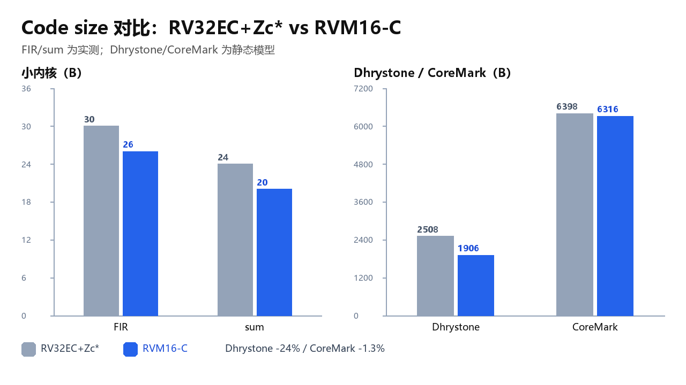

# 把 RISC-V 压到 16 位：RVM16-C 的取舍与数据

RVC 已经把常用指令压到 16 位，但 32 位指令仍然存在。RVM16-C 走得更远：**所有指令都是 16 位**，只保留 RVC 的 quadrant 00/01/10，把 quadrant 11 重定义成新的 16 位指令集。

这不是一个 RISC-V 标准扩展，而是一个**新 ISA**：标准 32 位二进制不兼容，换来的是极端的取指宽度和 code size 试验空间。

> 一句话结论：RVM16-C 在 Dhrystone 类代码上小 19-24%，CoreMark 类约持平；不是通用 C 的 code-size 银弹。

## 设计取舍

- **16 个 GPR**（x0-x15），不是 32 个；
- **no-flags**：不引入条件码，用融合比较分支；
- **2-address ALU 为主**，三地址被放弃；
- **融合分支**：c.bne / c.blt / c.blez，2 B；
- **GP/PC-relative**：lwgp/swgp 处理全局变量，lwpc 处理字符串地址和常量池；
- **F32**：16 个 FP 寄存器，20 条指令，无 FMA；
- **RVC 不变**：quadrant 00/01/10 一个 bit 都不改。

block 分配是 16/16：

| f4 | 用途 |
|---|---|
| 0-2 | ALU-12：add/sub/and/or/xor/sll/srl/sra/slt/sltu |
| 3 | GP/PC：lwgp/swgp/lwpc |
| 4 | M：mulh/div/rem |
| 5-7 | c.bne / c.blt / c.blez |
| 8 | lwc/swc |
| 9-13 | F32 |
| 14 | CSR |
| 15 | SYS |

*图 1：quadrant 11 的 16 个 f4 block。RVC 的 00/01/10 不变。*

RVC 基线里尽量加 Zc 扩展：

| 扩展 | 状态 | 用途 |
|---|---|---|
| Zcb | 必选 | c.mul、字节/半字 load/store、zext/sext |
| Zcmp | 必选 | cm.push/pop/popret，2 B prologue/epilogue |
| Zcf | 必选 | c.flw/c.fsw，F32 compressed load/store |
| Zcmt | 可选 | cm.jt/cm.jalt，switch table |

## 数据

FIR/sum 是 llvm-mc 汇编 + Spike 实测；Dhrystone/CoreMark 是静态模型，不是完整编译器产出的二进制。

| 内核 | RV32EC+Zc* | RVM16-C | 变化 |
|---|---:|---:|---:|
| FIR | 30 B | 26 B | -13.3% |
| sum | 24 B | 20 B | -16.7% |
| Dhrystone | 2508 B | 1906 B（+stub ≈2026） | -19% ~ -24% |
| CoreMark core | 6398 B | 6316 B | -1.3% |

*图 2：左为 FIR/sum 实测，右为 Dhrystone/CoreMark 静态模型。*

- Dhrystone 有 29 处 .L_MergedGlobals、53 处 .L.str；GP/PC 把地址构造从 8-12 B 降到 2 B，这是主要收益。
- CoreMark 是栈/结构体密集，GP=0，只有 32 处字符串；加入 Zcmp 的 2 B prologue/epilogue 后，模型约 -1.3%，仍可视作持平。
- 栈访问：Dhrystone 6.2%，CoreMark 11.7%。
- 分支 trampoline：Dhrystone 7/12，CoreMark 46/80（模型判断）。

## 结论

**严格 16 位不是通用 C 的 code-size 银弹。**

- 指针/全局/字符串密集的代码，RVM16-C 能小 19-24%（Dhrystone 模型）；
- 栈/结构体密集的代码，约持平或略小（CoreMark 模型 -1.3%）；
- 没有 flags、没有 32 位逃生口，某些循环仍然要靠 compare+branch；
- 和 Thumb 比，RVM16-C 少了 flags 和 32 位 Thumb-2，多了 RVC 兼容。

如果目标是“所有嵌入式都更小”，这个方案不成立；如果目标是“在 RVC 兼容前提下，给全局/字符串密集的嵌入式 C 一个更小的选择”，它是有数据的。

## 实现

- Spike-C：ALU、分支、GP/PC、LD/ST 已跑通，FIR/sum 结果 70/10；
- LLVM MC：+zc16q3 下独立助记符，分支 label fixup，FIR/sum 26/20；
- 还没有完整 LLVM 后端/Clang ABI，也没有 CoreMark 二进制；
- 代码和文档在 rva-e 仓库。

下一步是 MILP 最优性下界和完整 ABI/编译器；现在的“最优”只是 Dhrystone 上的有界结论。
