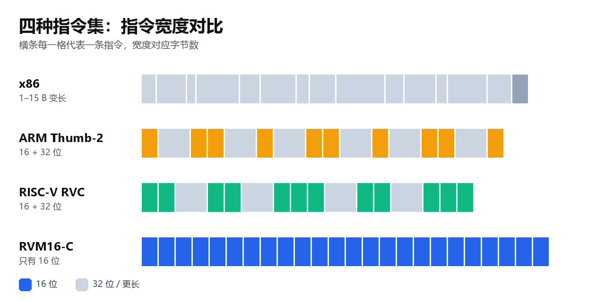
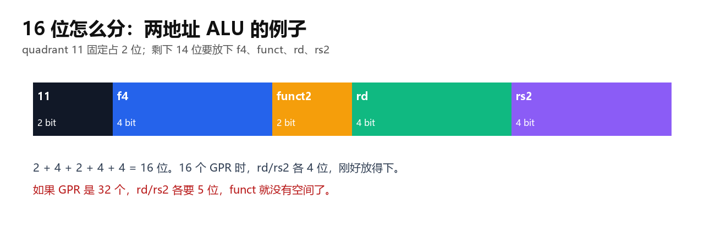

# 如果 RISC-V 只剩 16 位：一次关于代码体积的实验

**RVM16-C：给 code-size 敏感场景的一个独立 profile**

RVA profile 的讨论结果，是把 C 扩展放进基本要求。很多人对这个结果不满意。

让人觉得别扭的，是它把两件事绑在了一起：RVA 的软件生态，和 code-size 敏感场景的压缩指令。RVA 服务的是 application processor，应该优先性能和面积，而不是强制背上 16 位压缩的编码约束。

这篇文章讲我为什么对这个结果不满意，以及我想到的替代方案。我的目标：给嵌入式一个专门的 16 位 ISA，不要让 AP 侧和 RVV 为它买单。

## 1. RVA 与 C：背景与我的看法

### 1.1 RVA 是什么

RISC-V 的 profile 是一组扩展的打包，给软件一个共同目标；它不是“某一个核”。

RVA 是面向 application processor 的 profile：跑 Linux、跑用户态、强调性能。它不是“所有 RISC-V”的 profile，MCU、实时、安全场景有各自的取舍。

所以 RVA 的取舍应该服务 application processor，而不是把所有嵌入式需求都压给 RVA。

### 1.2 C 是什么

C 是 RISC-V 的压缩指令扩展（Compressed）。它保留 32 位指令作为基座，把最常见的操作压成 16 位。于是你得到了一个“大部分时候 16 位、必要时 32 位”的 ISA。

收益是：同样的 C 代码，常用指令变短，取指字节变少，I-cache 压力变小，Flash 占用也可能下降。

但 RVC 没有让 32 位指令消失。地址构造、栈帧、比较分支，仍然可能落回 32 位。

### 1.3 RVC 还不够

具体来说，有几个很典型的场景。

第一个是全局变量。访问一个全局 int，典型代码要先构造地址：

    lui  a5, %hi(g)
    lw   a4, %lo(g)(a5)
    ...
    sw   a4, %lo(g)(a5)

两条 32 位指令，只为了“找到 g”。如果 g 在 gp 附近，本来可以是一条 2 B 的 lwgp/swgp。

第二个是字符串和常量。printf("hello") 里的字符串地址、switch 跳转表、浮点常量，都可能在很远的地方，编译器要先 auipc/addi 或 lui/addi 把地址拼出来。

第三个是 prologue/epilogue（函数入口/出口的栈帧建立与恢复）。一个稍微像样的函数，进来先 push 一堆 callee-saved（被调用者保存）寄存器，出去再 pop。RVC 里栈调整和保存仍然常常落回 32 位；Zcmp 的 cm.push/cm.pop 是后来的扩展，不是 RVC 基座。

第四个是 compare+branch。if (a < b) 在 RISC-V 上要先 slt，再 bne；两条指令。x86/ARM 有 flags，可以 cmp + jcc；RISC-V 没有 flags，这是设计选择，但代价就是 compare 和 branch 分开。

这些问题单独看都不大，叠在一起就是：**RVC 让“常用指令”变短了，但没有让“地址构造、栈帧、比较分支”消失。**

### 1.4 编码空间：C 的成本不只是解码

16 位指令的低 2 位用来区分压缩指令和 32 位指令：

- 00/01/10：RVC 压缩指令，占 3/4 的 16 位模式；
- 11：32 位指令前缀，只剩 1/4。

所以 RVC 有编码空间代价：它把 16 位模式空间的 3/4 拿走了，32 位指令只能从 11 前缀扩展。

我在做自定义 RVV（RISC-V Vector 扩展）实现时，最直接的感受是：编码空间紧，不只是“少几条指令”，而是会改变整个实现。

- SEW/LMUL 放进 CSR：每条 vector 指令都对 vtype 有隐含依赖，硬件很难放开并行度；
- predicate 固定到 v0：predicate 和 data 挤在同一套寄存器命名空间，编译器要额外 copy，rename 也多一维；
- LMUL 动态寄存器组：编译器做寄存器分配/着色时要考虑宽度变化，硬件 rename/dispatch 也要按 LMUL 拆 uop；
- 编码空间不够，还会挡住一些更有价值的设计，比如 reuse 标记、scoreboard 标记、AI 的 FP4/INT4/MXFP8/LUT 指令。

这些不全是 C 造成的，RVV 自己的取舍也占很大部分。但 RVC 占掉 3/4 的 16 位模式，是 AP 侧扩展要面对的一个背景约束。

严格说，32 位编码空间仍有 2^30 个位置，“3/4”说的是 16 位模式，不是 32 位编码总量；但这个前缀约束存在。对 RVA 这种还要叠加 V/AI 扩展的 profile 来说，这是成本。

### 1.5 讨论结果：C 进了基本要求

RVA profile 的讨论里，C 最后被放进了基本要求。

支持的理由很具体：

- 工具链和库默认带 C，生态已经形成；
- application processor 也依赖 I-cache 和取指带宽；
- profile 需要一个共同的软件目标，C 变成 optional 会带来碎片化；
- 现有 RVA 二进制默认 C，去掉会破坏兼容。

这些理由都成立，但不等于所有人都满意。

### 1.6 为什么很多人不满意

不满意的核心是 RVA 的定位。

- RVA 是高性能 application processor，16 位压缩带来的编码约束、解码复杂度，换来的 density 对这类核未必划算；
- C 的初衷是嵌入式的 code size，不是 application 性能；RVA 继承 C，更多是生态和工具链的惯性；
- C 一旦 mandatory，所有 RVA 实现都要支持压缩解码，profile 的边界会变模糊；
- code-size 敏感的场景可以有自己的 profile，不必把 RVA 也拖进 16 位；
- 嵌入式的 code size 需求存在，但应该由嵌入式 profile 承担，不要让 AP 侧 CPU 为它买单。

所以“RVA 不该有 C”是一个立场，不是社区共识；反方也有道理。

### 1.7 我的看法

我的看法是：**RVA 不应该把 C 作为基本组成。**

我的目的：给嵌入式一个专门的 16 位 ISA；AP 侧继续走 32 位，把编码空间留给 V/AI。

我的策略是把两件事分开，不去删现有 RVA 的 C：

- RVA 继续服务 application processor；
- code-size 敏感场景拿一个独立 profile，自己承担“不兼容标准 32 位二进制”的代价。

长期看，如果 RVA 的目标是高性能 32 位，C 应该从 mandatory 里退出；但这需要 profile 版本和生态迁移。短期我不主张直接删，因为现有二进制和工具链的代价太大。

## 2. 三条路线：x86、Thumb、RVC

在动手之前，先看别人怎么解决 code size。

x86 是变长指令，1–15 B。它的 code density 很好，因为常用指令可以很短；代价是取指、解码、分支预测都更复杂。你今天在服务器上不觉得这是问题，但在很小的核上，变长解码是要付面积和功耗的。

ARM 的 Thumb 是另一条路：16 位子集为主，Thumb-2 再用 32 位长指令扩展。它比 x86 规整，比纯 32 位 ARM 小；但它仍然有 32 位指令，仍然有 flags。

RISC-V 的 RVC 是第三条：32 位基座 + 16 位压缩。它不改变 32 位指令，只是给常用指令加了一套 16 位别名。

这三条路有一个共同点：**都保留了更长的 32 位指令。** 这里的“32 位长指令”指标准 RISC-V 的 32 位编码，不是 16 位压缩形式。

*图 1：x86 是变长，Thumb-2/RVC 是 16+32，RVM16-C 只有 16 位；横条每格是一条指令。*

## 3. 所以有了 RVM16-C

问题变成：code-size 敏感场景到底需要什么样的 ISA？

我的答案是一个很窄的提案：在 RVC 兼容的前提下，给 code-size 敏感场景一个全部 16 位的 profile。它不追求更快，也不想替代 RISC-V。

具体做法：

- 保留 RVC 的 quadrant 00/01/10，一个 bit 都不改；
- 把 quadrant 11 重定义成新的 16 位空间；
- 所有指令都是 16 位，没有 32 位长指令；
- 只保留 16 个 GPR、16 个 FP 寄存器。

它是 RVC 旁边的一条路线，不是替代。

## 4. 16 位里的编码空间：为什么是 16 个寄存器

RVM16-C 最早是 32 GPR，后来才降到 16。

最早做的 RVM16-A：32 个 GPR，FLEN=32，16 个 f4 block，仍然严格 16 位。A 能跑，但它很快暴露了问题：**编码空间不够。**

先看位数怎么分。16 位指令，quadrant 11 已经占掉 2 位，f4 占 4 位，只剩 10 位。

如果是两地址 ALU：

- rd 4 位；
- rs2 4 位；
- funct 2 位。

刚好 10 位。

*图 2：两地址 ALU 的 16 位字段分配。*

如果寄存器是 32 个：

- rd 5 位；
- rs2 5 位；
- 已经 10 位，funct 没了。

这还没算三地址。三地址要 rd/rs1/rs2 三个 4 位字段，12 位，加上 f4 和 quadrant，16 位根本放不下。

所以 32 GPR 的方案，要么牺牲 block 数，要么牺牲寻址模式，要么退化成“每条指令都只能做很少的事”。

中间认真考虑过 8 GPR：如果 16 个放不下，就退到 8 个。但 8 个 GPR 的 spill（寄存器溢出）/ABI（应用二进制接口）代价太大。16 个是一个折中：4 位寄存器字段，刚好够两地址 + funct，也够 GP/PC 的 rd 和 offset。

这就是为什么 RVM16-C 是 16 GPR，而不是 32，也不是 8。

## 5. 三地址：听起来很美

三地址指令看起来更“正统”：add rd, rs1, rs2，一条指令算完，不用先 move。

我一开始也问过：三地址是不是最好有？也真的加了 c.add3/c.sub3 的原型。

结论是：**在 16 位里，三地址代价太高。**

- 三个 4 位寄存器字段就是 12 位；
- 加上 f4、quadrant，几乎没有空间放 funct；
- 为了三地址，你要么减少 ALU 操作数，要么减少 block；
- 而两地址 rd = rd op rs2，配合融合分支，已经能把大多数 C 表达式压到 2 B。

所以最终 ALU 是 12 条两地址指令：add/sub/and/or/xor/sll/srl/sra/slt/sltu。三地址原型留在了早期实验里，没有进入最终 ISA。

三地址不是不好，只是在 16 位的编码空间下不划算。

## 6. 16 个 block 怎么分

16 位空间里，f4 有 16 个 block。你可以把它看成 16 个编码槽位，每个槽位放一类指令。

最后的分配：

| f4 | 用途 |
|---|---|
| 0–2 | ALU-12 |
| 3 | GP/PC：lwgp/swgp/lwpc |
| 4 | M：mulh/mulhsu/mulhu/div/divu/rem/remu |
| 5–7 | c.bne / c.blt / c.blez |
| 8 | lwc/swc |
| 9–13 | F32 |
| 14 | CSR |
| 15 | SYS |

*图 3：quadrant 11 的 16 个 f4 block。RVC 的 00/01/10 不变。*

这个分配不是随意定的：

- ALU 用 3 个 block，因为 10 条运算 + 保留要空间；
- 分支用 3 个，因为 bne/blt/blez 要不同的 offset 宽度；
- F32 用 5 个，因为 20 条浮点指令要分；
- CSR/SYS 各 1 个，够用但不浪费。

block 数是硬约束。你多给 ALU 一个 block，就要从别的地方拿。

## 7. 指令集长什么样

### 7.1 flags 是什么

x86 的 EFLAGS、ARM 的 APSR，里面有一组条件标志：zero、sign、carry、overflow。比较指令会把结果写进这些标志，后面的条件跳转再读它们。

例如 x86：

    cmp eax, ebx
    jl  label

ARM 也类似：

    cmp r0, r1
    blt label

这里的 cmp 不产生一个“结果寄存器”，它只改 flags；jl/blt 再根据 flags 决定跳不跳。

RISC-V 没有这套 flags。比较指令把结果写进一个普通 GPR：

    slt t0, a0, a1
    bne t0, zero, label

这多了一条指令，但处理器里没有隐藏的条件状态：没有“上一条指令改了 flags、下一条指令依赖 flags”的假依赖，也不需要为 flags 做保存/恢复。

RVM16-C 继承 RISC-V 的 no-flags 设计，不引入条件码。这样 16 位编码里不需要留 condition-code 字段，分支条件直接由操作码决定。

### 7.2 no-flags 与融合分支

没有 flags，compare 和 branch 就要分开；RVM16-C 的补偿是**融合比较和分支**。

- c.bne rs1, rs2, off：不相等就跳；
- c.blt rs1, rs2, off：小于就跳；
- c.blez rs, off：小于等于零就跳。

这样 if (a < b) 不需要先 slt 再 bne，而是一条 2 B 的分支。

代价是：不是所有条件都有融合分支。c.beqz/c.bnez 是 RVC 自带的零比较分支；beq 先用 xor 把两个数比较成零，再 c.beqz；bge 用交换操作数的 blt；bgeu/bltu 要 sltu + c.beqz。这些情况会多一条指令。

这是一个取舍：**常见条件更短，罕见条件多一条。**

### 7.3 GP/PC-relative

全局变量和字符串地址是 RVC 最痛的地方。

RVM16-C 留了 gp=x3，用 lwgp/swgp 访问 gp 附近的小全局；用 lwpc 从 PC 附近取 32 位字面量。

- lwgp/swgp：地址 = gp + off5*4，off5 0–124 B；
- lwpc：地址 = pc + off5*4，取字符串地址/常量池。

这样“找到 g”从两条 32 位指令变成一条 2 B 指令。

代价是：gp 附近的全局要链接器配合；lwpc 的 124 B 窗口需要常量池布局；超出范围要回退到多指令序列。

### 7.4 LD/ST

lwc/swc 只支持 4 种 base：x8、x9、sp、gp；off2 按访问宽度缩放。

为什么只有 4 种 base？因为 16 位里要留空间给 reg 和 off。x8/x9 是编译器常用的临时基址，sp 是栈，gp 是全局。

字节/半字访问交给 Zcb 的 c.lbu/c.lh/c.lhu/c.sb/c.sh。

### 7.5 M 与 F32

M 有 mulh/mulhsu/mulhu/div/divu/rem/remu；c.mul 走 Zcb。

F32 有 16 个 FP 寄存器、20 条指令、无 FMA。fcmp 没有 rd 字段，固定写 x7，再由编译器搬到 x8–x15——这是 16 位编码下的妥协。

### 7.6 CSR 与 SYS

CSR 有 csrr/csrw/csrs/csrc；SYS 有 ecall/ebreak/mret/wfi/fence/fence.i。

csr4=0 时走 cold 路径，12 位 CSR 地址放在 x7；csr4=1–15 是热 CSR。

## 8. Zc：复用 RVC 的压缩指令

RVM16-C 不重新发明压缩指令，而是尽量继承 RVC 的 Zc 扩展：

- Zca：RVC 的基础压缩指令，继承；
- Zcb：c.mul、字节/半字 load/store、zext/sext；
- Zcmp：cm.push/pop/popret/popretz，2 B prologue/epilogue；
- Zcf：c.flw/c.fsw/c.flwsp/c.fswsp；
- Zcmt：cm.jt/cm.jalt，switch table；对 M/F 可选，对 E profile 必选；
- Zcd：编码保留给未来的 D 变体；
- Zcmop：没有加入。

Zcmp 的用法是 save-all：

    cm.push {ra, s0-s7}, -48
    cm.pop  {ra, s0-s7}, 48

16 GPR 下会多保存 x8–x15，这是有意的取舍：用一点栈空间换 2 B 的 prologue/epilogue。

Zcb 里有几个容易忽略的依赖：c.sext.b/h 需要 Zbb；c.zext.w 在 RV32 需要 Zba。它们不是无条件可用的，手册里已经写成 optional。

## 9. 和 Thumb 比 code size

Thumb 是最直接的对照。

RVM16-C 在机制上可以和 Thumb 比 code size。原因有几条：

- 所有指令 16 位，没有 32 位 fallback；Thumb-2 仍会在复杂寻址/大立即数时用 32 位；
- GP/PC-relative 把全局/字符串地址构造压到 2 B；
- c.bne/c.blt/c.blez 把 compare+branch 融合成 2 B；
- Zcmp 把 prologue/epilogue 压到 2 B；
- 16 GPR 让 rd/rs2 只要 4 位，给 funct/offset 留空间。

但 Thumb-2 也有它的优势：

- 有 32 位指令，复杂操作不用拆成多条 16 位；
- 有 flags，compare/branch 更灵活；
- 编译器成熟，寄存器分配和指令选择经过多年打磨。

该问的是：**在同样的 C、同样的优化级别下，RVM16-C 能不能进入 Thumb-2 的 ±10%？**

同源 C 的 Thumb 对比是下一步要做的实验。已有数据是 FIR/sum 对 RV32EC+Zc* 的实测，以及 Dhrystone/CoreMark 的模型。因此现在能说的是：

> RVM16-C 的目标是进入 Thumb 的 code-size 量级，机制上具备可比性；但“已经比 Thumb 小”需要同源 C 的实测。

下一步应该做的对比实验：

1. 同一份 Dhrystone/CoreMark/Linpack C；
2. clang -O2 -mthumb 生成 Thumb-2 二进制；
3. RVM16-C 用 translator/后端生成二进制；
4. 比 .text、栈访问、分支数量、trampoline（跳转垫片）；
5. 同时记录 IPC/周期，避免只看 code size。

## 10. 数据：哪些是实测，哪些是模型

| 内核 | RV32EC+Zc* | RVM16-C | 性质 |
|---|---:|---:|---|
| FIR | 30 B | 26 B | llvm-mc + Spike 实测 |
| sum | 24 B | 20 B | llvm-mc + Spike 实测 |
| Dhrystone | 2508 B | 1906 B（+stub ≈2026） | 静态模型 |
| CoreMark core | 6398 B | 6316 B | 静态模型 |

*图 4：左为 FIR/sum 实测，右为 Dhrystone/CoreMark 静态模型。*

这张表里：

- FIR/sum 是 RVM16-C 二进制实测，26/20 B，比 RV32EC+Zc* 小；
- Dhrystone 的 1906 B 是模型，不是编译器输出；加 stub 约 2026 B，仍比 2508 小；
- CoreMark 的 6316 B 也是模型，只小 1.3%，落在模型误差 ±5–10% 内，只能算**持平**；

Dhrystone 为什么收益大？因为它有 29 处 .L_MergedGlobals、53 处 .L.str；GP/PC 把地址构造从 8–12 B 降到 2 B。

CoreMark 为什么持平？因为它是栈/结构体密集，GP=0，只有 32 处字符串；Zcmp 省下的 prologue 被其他开销抵消。

三个 benchmark 已经作为 RV32EC+Zc* baseline 跑完：Dhrystone 自检正确，CoreMark CRC 0x4983，Linpack float n=50 KFLOPS 5.00；它们不是 RVM16-C 的 C 二进制。

## 11. 方案演进

方案演进大致是：

1. RVM16-A：32 GPR、FLEN=32、16 block，先证明“16 位编码空间”可行。
2. 转向 C：32 → 16 GPR；8 GPR 作为备选被否；F32 保留。
3. 编码探索：三地址 c.add3/c.sub3 原型 → 放弃；两地址 + 融合分支。
4. 指令集成形：ALU-12、bne/blt/blez、GP/PC、LD/ST、M、F32、CSR/SYS。
5. Zc 集成：Zca/Zcb/Zcmp/Zcf/Zcmt，Zcd 保留，Zcmop 不加。
6. 定位：给 code-size 敏感场景一个独立 profile，不替代 RVC；Thumb 作为 code-size 对照。

## 12. 结论

**严格 16 位不能让所有 C 代码都变小。**

- 指针/全局/字符串密集的代码，RVM16-C 能小 19–24%（Dhrystone 模型）；
- 栈/结构体密集的代码，约持平（CoreMark 模型 -1.3%，在误差内）；
- 没有 flags、没有 32 位长指令，某些循环仍然要靠 compare+branch；
- 和 Thumb 比，RVM16-C 少了 flags 和 32 位 Thumb-2，多了 RVC 兼容；
- 和 RVC 比，它把“所有指令”都压到 16 位，代价是标准 32 位二进制不兼容。

如果目标是“所有嵌入式都更小”，这个方案不成立；如果目标是“在 RVC 兼容前提下，给 code-size 敏感场景一个独立 profile”，它是有数据、有原型、有 benchmark 的提案。

## 13. 讨论：想听到的反馈

1. 单独做一个 code-size profile，和“改 RVA/改 RVC”相比，是不是更合适的层次？
2. 16 GPR 够不够？如果退到 8 GPR，spill 和 ABI 的代价是否值得？
3. 没有 32 位长指令，对性能/编译器的风险能不能接受？
4. Zbb/Zba 要不要进这个 profile？还是让 c.sext/c.zext.w 继续 optional？
5. 哪些实际 workload 最能说明“RVC 不够、但又不想上 Thumb-2”？

## 14. 相关工作与横向对比

| | RVC | RVM16-C | ARM Thumb-2 | x86 |
|---|---|---|---|---|
| 指令宽度 | 16 + 32 位 | 只有 16 位 | 16 + 32 位 | 1–15 B 变长 |
| 32 位长指令 | 有 | 无 | 有 | 不适用 |
| GPR 数量 | 32 | 16 | 16（Thumb 状态） | 8/16 |
| 条件码/flags | 无 | 无 | 有（APSR） | 有 |
| 压缩 load/store | Zcf/Zcb | Zcf/Zcb | 有 | 不适用 |
| 典型 prologue | push/pop（Zcmp 可选） | Zcmp | push/pop | push/pop |
| 二进制兼容 | RISC-V | 新 ISA | ARM | x86 |

四种方案解决 code size 的层次不同：

- RVC 是“32 位基座 + 16 位压缩”，保留 32 位长指令；
- Thumb-2 是“16 位为主 + 32 位扩展”，有 flags 和 32 位长指令；
- x86 用变长指令换密度，代价是解码复杂；
- RVM16-C 是“全部 16 位、没有 32 位长指令”，用兼容性换固定取指宽度。

## 15. 接受/放弃判据

一个 code-size profile 不能只靠“看起来更小”。我建议用下面的判据决定是否继续：

- Dhrystone 比 RV32EC+Zc* 小 **≥15%**；
- CoreMark 不退化超过 **2%**；
- 同源 C 下，和 Thumb-2 的 code size 差距在 **±10%** 内；
- spill/reload 增量不超过 **5%**；
- 分支 trampoline 比例不超过 **2%**；
- 所有 benchmark 能编译、能跑、自检/CRC 通过。

如果 Dhrystone 收益低于 15%，或者 CoreMark 明显退化，这个 profile 就不值得单独存在；如果 Thumb 对比输得很明显，就应该回到 RVC/Zc 路线，而不是继续加指令。

## 16. 性能、面积、功耗

code size 只是第一维。16 位固定宽度的影响至少有三面：

- **取指**：16 位对齐，取指带宽和 cache 行利用率可能更好；
- **IPC（每周期指令数）**：没有 32 位长指令，复杂操作要拆成多条 16 位指令，动态指令数可能上升；
- **面积/功耗**：16 GPR + 16 FP 寄存器比 32 GPR 小，但译码/控制逻辑和更多指令数可能抵消。

下一步需要补：

- RTL 或周期级模型，跑同样 workload；
- 统计动态指令数、取指字节、分支数；
- 对比 RV32EC+Zc* 和 Thumb-2 的 cycles/byte。

## 17. ABI（应用二进制接口）与工具链

16 GPR 不是“减少寄存器数量”这么简单：

- 调用约定要重新定义参数/返回值/callee-saved；
- varargs、结构体返回、浮点参数需要新 ABI；
- Zcmp 的 save-all 会多保存 x8–x15，要权衡；
- 链接器 relaxation、relocation、trampoline 要支持 16 位分支范围；
- 调试信息、unwinder、库、启动代码都要适配；
- 和 RVC 的兼容只到编码层，ABI 不兼容 32 GPR。

## 18. 验证

已经做过的验证：

- f4 block 分配有检查；
- 主要指令组有指令级期望值测试；
- FIR/sum、Zcmp/Zcmt/Zcf 有运行时测试；
- 三个 benchmark 作为 RV32EC+Zc* baseline 跑完。

## 19. 实际 workload 与生态

Dhrystone/CoreMark 是微基准，不是产品代码。要证明这个 profile 有价值，需要：

- 实际嵌入式 C 代码的 code-size 分布；
- 按模块统计：全局/字符串、栈、分支、常量池；
- 和 RVC、Thumb-2 的同源 C 对比；
- 工具链/库/调试器/OS 的支持成本；
- 生态碎片化：多一个 ISA profile，编译器和库要不要多一套。

## 20. 安全

固定 16 位、没有 32 位长指令，安全影响需要单独评估：

- 固定宽度可能简化 decode，但不自动等于更安全；
- 没有 32 位指令，某些攻击面（长指令、非对齐）变化；
- ROP/JOP（返回/跳转导向编程）、CFI（控制流完整性）、指针完整性需要单独评估；
- 16 GPR 的寄存器压力可能增加栈 spill，影响泄漏面。

这些目前都只是问题，不是结论。

## 21. 代码与复现

- GitHub: https://github.com/miloee/rvm16
- Spike 分支: https://github.com/miloee/rvm16/tree/spike-c/spike-c
- tags: rvm16c-v0.1, spike-c-v0.1
- 手册: https://github.com/miloee/rvm16/blob/main/docs/RVM16-C-Manual.adoc
- 手册 HTML: https://github.com/miloee/rvm16/blob/main/docs/RVM16-C-Manual.html
- 评估: https://github.com/miloee/rvm16/blob/main/docs/RVM16-C-Evaluation.md
- 指令测试: https://github.com/miloee/rvm16/tree/main/bench/c
- Linpack 端口: https://github.com/miloee/rvm16/tree/main/bench/linpack
- LLVM 编码层 patch: https://github.com/miloee/rvm16/blob/main/patches/llvm/0003-RISCV-Zvmc-MC.patch
- Spike patch: https://github.com/miloee/rvm16/blob/main/patches/spike-c/0001-spike-c-full.patch

复现入口：

    git clone https://github.com/miloee/rvm16
    cd rvm16/spike-c
    mkdir build && cd build
    ../configure --prefix=$PWD/install
    make -j20

## 22. 术语表

- **RVA profile**：RISC-V 面向 application processor 的 profile，强调性能、生态和软件兼容。
- **AP / application processor**：应用处理器，跑 Linux/用户态，强调性能。
- **RVC**：RISC-V 的压缩指令扩展（Compressed），用 16 位编码表示常用指令。
- **quadrant / f4 / block**：16 位编码里用低 2 位选 quadrant，用接下来的 4 位（f4）选指令块。
- **32 位长指令**：标准 RISC-V 的 32 位编码，不是 16 位压缩形式。
- **GP/PC-relative**：以 gp 或 PC 为基准加偏移访问数据，省掉构造完整地址的指令。
- **prologue / epilogue**：函数入口/出口的栈帧建立与恢复。
- **callee-saved**：被调用者保存寄存器，函数返回前要恢复。
- **flags**：x86 EFLAGS / ARM APSR 里的条件标志；RISC-V 没有这套东西。
- **fused branch**：把比较和分支合成一条指令，例如 c.blt。
- **ABI**：应用二进制接口，规定参数、返回值、寄存器保存等调用约定。
- **spill / reload**：寄存器不够时把值写到栈，再读回来。
- **trampoline**：跳转垫片，分支超出范围时用一段小跳转中转。
- **relaxation / relocation**：链接器对指令序列的松弛优化，以及重定位。
- **IPC**：每周期执行的指令数。
- **Zca / Zcb / Zcmp / Zcf / Zcmt / Zcd / Zcmop**：RVC 及 Zc 系列压缩扩展的不同子集。
- **RVV**：RISC-V Vector 扩展。
- **SEW / LMUL / vtype**：向量元素宽度、向量寄存器组倍数、向量类型 CSR。
- **predicate / v0**：向量掩码；RVV 把 v0 固定为掩码寄存器。
- **rd / rs2**：指令里的目标寄存器字段和第二个源寄存器字段。
- **off5**：5 位偏移字段，按 4 字节缩放。
- **varargs**：可变参数函数。
- **fcmp**：浮点比较指令。
- **ROP / JOP / CFI**：返回导向编程、跳转导向编程、控制流完整性。
