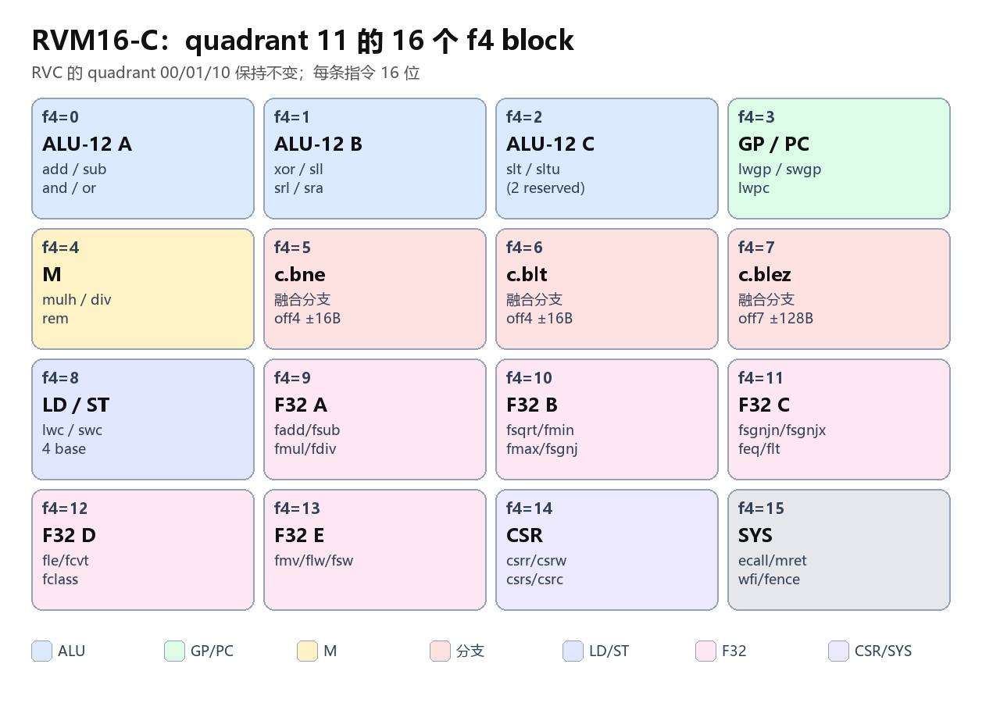

# 把 RISC-V 压到 16 位：RVM16-C 的完整探索

> 一句话结论：RVM16-C 在 FIR/sum 上实测更小，Dhrystone 模型小 19–24%，CoreMark 约持平；它不是通用 C 的 code-size 银弹，而是“RVC 兼容、面向 code-size 敏感场景”的一个独立 profile 提案。

## 1. 背景：code size 为什么又回到桌面

x86 靠变长指令（1–15 B）换 code density，代价是取指/解码复杂；ARM 的 Thumb 用 16 位子集，再用 Thumb-2 的 32 位指令做逃生口；RISC-V 的 RVC 则是“32 位基座 + 16 位压缩”，常用指令变短，但 32 位指令始终存在。

RVA 系列 application profile 把 C 作为基本组成之一，解决的是“应用处理器也要 code size”的问题。但在更小的嵌入式场景里，RVC 仍然不够：prologue/epilogue、全局地址、字符串地址、常量池、分支，仍然会落回 32 位指令。

我的判断是：**不应该去改 RVA，也不应该要求所有 RISC-V 都变成 16 位；应该给 code-size 敏感场景一个额外的 profile。** RVM16-C 就是这个 profile 的提案：保留 RVC 的 quadrant 00/01/10，一个 bit 都不改；把 quadrant 11 重定义成新的 16 位空间；所有指令都是 16 位，没有 32 位逃生口。

## 2. 起点：RVM16-A，32 个 GPR

最早做的是 RVM16-A：32 个 GPR，FLEN=32，16 个 f4 block，仍然严格 16 位；32 GPR 是作为对照。A 有完整的手册、Spike 实现和 LLVM MC。

但 32 GPR 的方案里，编码空间很快不够用：rd/rs1/rs2 各 5 位就是 15 位，只剩 1 位做 opcode；要么牺牲 block 数，要么牺牲寻址模式。A 能跑，但它没有回答“16 位里怎么把 C 写小”这个问题。

## 3. 第一次大转向：32 → 16 GPR

真正做 C 时，我先把寄存器数量从 32 降到 16：

- x0–x15，x16–x31 不存在；
- RVC 中任何寻址 x16–x31 的形式都非法；
- FP 也只保留 f0–f15。

中间认真考虑过 8 GPR：如果 16 个放不下，就退到 8 个。但 8 个 GPR 的 spill/ABI 代价太大，最后选了 16 个——刚好让 4 位 rd/rs2 和三地址/GP/PC 的字段都能放下。

这一步是后面所有编码的前提：**寄存器数量不是“保持不变”，而是从 32 降到 16。**

## 4. 编码：三地址试过，最后放弃

一开始我问过“三地址是不是最好有”，也真的加了 c.add3/c.sub3 的原型。结论是：三地址在 16 位里太贵。

- 三地址要 rd/rs1/rs2 三个 4 位字段，再加 f4/funct，block 很快被吃满；
- 两地址 rd = rd op rs2 加融合分支，已经能把大多数 C 表达式压到 2 B；
- 三地址没有带来可观测的 code-size 收益，反而让 block 分配变紧。

最终 ALU 是 12 条两地址指令：add/sub/and/or/xor/sll/srl/sra/slt/sltu。三地址原型保留在早期实验里，但没有进入最终 ISA。

16 个 f4 block 的分配：

| f4 | 用途 |
|---|---|
| 0–2 | ALU-12 |
| 3 | GP/PC：lwgp/swgp/lwpc |
| 4 | M：mulh/mulhsu/mulhu/div/divu/rem/remu |
| 5–7 | c.bne / c.blt / c.blez |
| 8 | lwc/swc |
| 9–13 | F32 |
| 14 | CSR |
| 15 | SYS |

*图 1：quadrant 11 的 16 个 f4 block。RVC 的 00/01/10 不变。*

## 5. 指令集成形

- **no-flags**：不引入条件码，用 c.bne/c.blt/c.blez 融合比较和分支；beq 展开成 xor + c.beqz，bge 用交换操作数的 blt。
- **GP/PC-relative**：lwgp/swgp 用 gp=x3 访问小全局，lwpc 从 PC 附近取字符串地址/常量池；off5 0–124 B。
- **LD/ST**：lwc/swc，base 只有 x8/x9/sp/gp 四种，off2 按访问宽度缩放。
- **M**：mulh/mulhsu/mulhu/div/divu/rem/remu；c.mul 走 Zcb。
- **F32**：16 个 FP 寄存器，20 条指令，无 FMA；fcmp 没有 rd 字段，固定写 x7，再由编译器搬到 x8–x15。
- **CSR/SYS**：csrr/csrw/csrs/csrc；ecall/ebreak/mret/wfi/fence/fence.i。
- **Zc**：Zca 继承；Zcb、Zcmp、Zcf 必选；Zcmt 对 M/F 可选、对 E profile 必选；Zcd 编码保留给未来的 D 变体；Zcmop 没有加入。
- **Zcmp save-all**：cm.push {ra,s0-s7}, -48 / cm.pop，2 B prologue/epilogue；16 GPR 下会多保存 x8–x15，这是有意的取舍。

Zcb 里有两个容易忽略的依赖：c.sext.b/h 需要 Zbb；c.zext.w 在 RV32 需要 Zba。它们不是无条件可用的，手册里已经写成 optional。

## 6. Spike 原型：从“能跑”到“跑对”

Spike-C 是改过的 Spike：insn_length=2，32 位 opcode 被过滤，quadrant 11 的 block 走新的 insn。

最早只跑 FIR/sum：

- FIR 26 B，x8=70；
- sum 20 B，x8=10。

后面一块块补：

- 分支 bne/blt/blez；
- GP/PC：lwgp/swgp/lwpc；
- LD/ST：lwc/swc；
- Zcmp：cm.push/pop，x10=7；
- Zcmt：jvt=0x80000240（64 B 对齐），cm.jt 0 跳转成功；
- Zcf：c.flw/c.fsw/c.flwsp/c.fswsp 编码验证。

再往后是整组测试：

- ALU-12 全 10 条；
- M 全 7 条；
- F32 全 20 条；
- CSR csrw/csrr/csrs/csrc；
- SYS ecall/ebreak/mret/fence/fence.i/wfi；
- Zcb 的 lbu/lh/lhu/sb/sh/zext.b/h/sext.b/h/not。

这里踩过的坑：

- Zcmt 测试一开始用 x31 传 CSR 地址；但 C 只有 x0–x15，x31 是非架构寄存器。后来把 cold CSR 路径改成 x7，测试也改成 x7。
- fcmp 在 A 里写 x31；C 里同样改成 x7。
- WFI 一开始不进 handler：mstatus 的 MIE、mtvec、mie、mtimecmp 要按顺序设；最后用 CLINT timer 跑通，handler 实际执行、wfi 返回。

## 7. LLVM MC：先解决“能编码”

完整后端没有做，先做 MC：

- +zc16q3 下独立助记符：c.addc/c.subc/c.andc/c.orc/c.xorc/c.sllc/c.srlc/c.srac/c.sltc/c.sltuc，c.bnec/c.bltc/c.blezc，c.lwgc/c.swgc/c.lwpc，c.lwc/c.swc；
- 分支 label fixup：fixup_riscv_zvmc_branch4/7；
- FIR/sum 用 .Lloop/.Lend 汇编，26/20 B，Spike 跑 70/10。

MC 阶段也踩了坑：操作数类型、HasStdExtZvmc、InstFormat、ELF relocation、branch offset 0 的 fixup，都是逐个补的。

## 8. 数据：哪些是实测，哪些是模型

| 内核 | RV32EC+Zc* | RVM16-C | 性质 |
|---|---:|---:|---|
| FIR | 30 B | 26 B | llvm-mc + Spike 实测 |
| sum | 24 B | 20 B | llvm-mc + Spike 实测 |
| Dhrystone | 2508 B | 1906 B（+stub ≈2026） | 静态模型 |
| CoreMark core | 6398 B | 6316 B | 静态模型 |
| Linpack | — | — | 只有 baseline float 端口，无 C 二进制 |

*图 2：左为 FIR/sum 实测，右为 Dhrystone/CoreMark 静态模型。*

解释：

- Dhrystone 有 29 处 .L_MergedGlobals、53 处 .L.str；GP/PC 把地址构造从 8–12 B 降到 2 B，这是主要收益。
- CoreMark 是栈/结构体密集，GP=0，只有 32 处字符串；加入 Zcmp 后模型约 -1.3%，落在模型误差 ±5–10% 内，只能算**持平**，不能算更小。
- 栈访问：Dhrystone 6.2%，CoreMark 11.7%。
- 分支 trampoline：Dhrystone 7/12，CoreMark 46/80（模型判断）。

三个 benchmark 的实际运行是 **RV32EC+Zc* baseline**，不是 RVM16-C 二进制：

- Dhrystone：自检值全部正确，RC=0；
- CoreMark：seeds 0，CRC final 0x4983，“Correct operation validated”，RC=0；
- Linpack：single-precision 端口，n=50，KFLOPS 5.00，RC=0；clock 是确定性 stub，只证明端口和输出路径。

## 9. 全流程复盘

按阶段看，这个项目走过：

1. 最初想找 RVV 的修改流程，后来明确：这是标量 ISA，不是向量。
2. RVM16-A：32 GPR、FLEN=32、16 block，先证明“16 位编码空间”可行。
3. 转向 C：32 → 16 GPR；8 GPR 作为备选被否；F32 保留。
4. 编码探索：三地址 c.add3/c.sub3 原型 → 放弃；两地址 + 融合分支。
5. 指令集成形：ALU-12、bne/blt/blez、GP/PC、LD/ST、M、F32、CSR/SYS。
6. Zc 集成：Zca/Zcb/Zcmp/Zcf/Zcmt，Zcd 保留，Zcmop 不加。
7. Spike-C 原型：从 FIR/sum 到 ALU/M/F32/CSR/SYS/Zcb/WFI 全组测试。
8. LLVM MC：独立助记符、分支 fixup、FIR/sum 26/20。
9. 评估：静态模型、spill/trampoline/globals、block-count 有界最优。
10. benchmark：Dhrystone/CoreMark/Linpack 的 RV32EC+Zc* baseline 全部跑完。
11. 文档与仓库：先写手册再编码；按 RISC-V 社区 AsciiDoc 风格重写，补 WaveDrom 编码图；最后是知乎草稿和 GitHub。

## 10. 结论与讨论

**严格 16 位不是通用 C 的 code-size 银弹。**

- 指针/全局/字符串密集的代码，RVM16-C 能小 19–24%（Dhrystone 模型）；
- 栈/结构体密集的代码，约持平（CoreMark 模型 -1.3%，在误差内）；
- 没有 flags、没有 32 位逃生口，某些循环仍然要靠 compare+branch；
- 和 Thumb 比，RVM16-C 少了 flags 和 32 位 Thumb-2，多了 RVC 兼容；
- 和 RVC 比，它把“所有指令”都压到 16 位，代价是标准 32 位二进制不兼容。

如果目标是“所有嵌入式都更小”，这个方案不成立；如果目标是“在 RVC 兼容前提下，给 code-size 敏感场景一个独立 profile”，它是有数据、有 Spike、有 MC、有 benchmark 的提案。

## 11. 代码与复现

- GitHub: https://github.com/miloee/rvm16
- Spike 分支: https://github.com/miloee/rvm16/tree/spike-c/spike-c
- tags: rvm16c-v0.1, spike-c-v0.1
- 手册: docs/RVM16-C-Manual.adoc / .html
- 评估: docs/RVM16-C-Evaluation.md
- 指令测试: bench/c/
- Linpack 端口: bench/linpack/
- LLVM MC patch: patches/llvm/0003-RISCV-Zvmc-MC.patch
- Spike patch: patches/spike-c/0001-spike-c-full.patch

复现入口：

    git clone https://github.com/miloee/rvm16
    cd rvm16/spike-c
    mkdir build && cd build
    ../configure --prefix=$PWD/install
    make -j20

## 12. 还没做的

- 完整 LLVM 后端/Clang ABI/libc：没有它，就没有 RVM16-C 的 C benchmark 二进制；
- RVM16-C 自己的 Dhrystone/CoreMark/Linpack：现在只有 RV32EC+Zc* baseline；
- RVC 全编码逐条枚举；
- MILP 全局最优性下界；
- Zbb/Zba 是否进入 profile 的最终决策；
- 面积/功耗/频率，而不只是 code size。

## 可选补充（讨论用）

如果要把这篇文章再往前推，可以加：

1. 和 Thumb-2、xtensa、RV32E 的同源 C 对比；
2. 真实产品代码的 code-size 分布，而不只是 Dhrystone/CoreMark；
3. 完整 ABI 下的 register pressure/spill 数据；
4. 16 位取指对 IPC/功耗的影响；
5. RVC 兼容的边界 case（链接器 relaxation、relocation、trampoline）；
6. 形式化的编码冲突检查；
7. 为什么不做 32 位逃生口，以及它带来的性能风险；
8. 生态碎片化与工具链支持成本。
